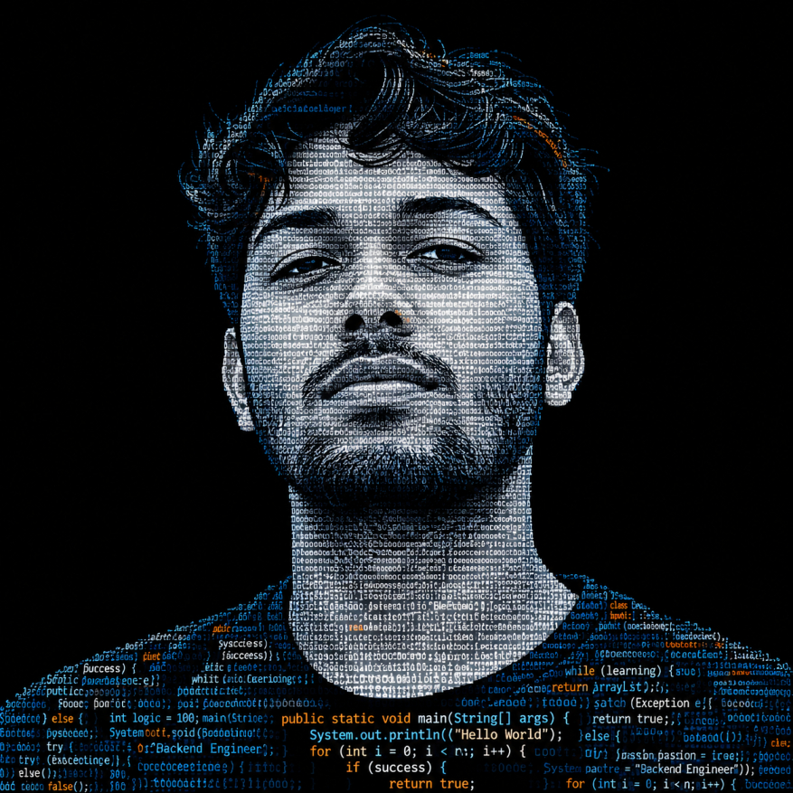

 

 

  

  

 

<table>
<tr>
<td width="58%" valign="top">

<h2>⚡ Hi, I'm Abhishek Maury.</h2>

 

  

I'm a **Computer Science Engineering student** with a growing passion for building software and understanding how things work behind the scenes.

I started with Java, where I enjoy turning logic into working programs, solving challenging problems, and learning by experimenting.

### 🚀 What drives me

-  Understanding concepts instead of memorising code.
-  Creating practical projects from what I learn.
-  Becoming better through consistent practice.

### 🎯 Areas of interest

`Java` · `Backend Development` · `Problem Solving` · `Software Engineering`

 

</td>
<td width="42%" valign="top">

<h3>◈ QUICK FACTS</h3>

**Sandip University, Nashik**

 

**Expected graduation**

 

**Spring Boot · REST APIs · SQL / MySQL · DSA**

 

**Software Engineering Opportunities**

  

</td>
</tr>
</table>

 

 

 

  

  

 

Projects I plan to build next. None of these are started yet.

  

<table>
<tr>
<td align="center" width="33%" valign="top">

**Spring Boot REST API**

REST API backed by MySQL

</td>
<td align="center" width="33%" valign="top">

**Auth & Authorization System**

Secure login and role-based access

</td>
<td align="center" width="33%" valign="top">

**Repository Setup Verification Platform**

Multi-language repo setup checks

</td>
</tr>
</table>

 

    

 

 

 

 

 

  

  

 

### Looking for a software engineering internship

I want to contribute, learn from experienced engineers, and keep building.

 

  

**Understand it first. Then build it properly.**

